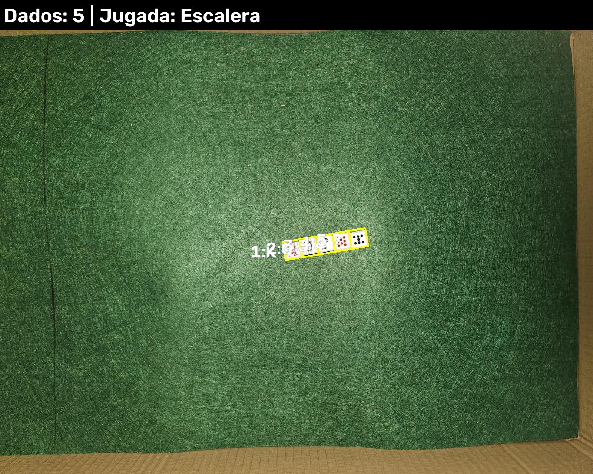

# Dados de póker con visión artificial clásica

Proyecto de clase de Inteligencia Artificial: desarrollar un sistema que localice dados en una fotografía cenital, identifique sus caras y calcule la jugada. Implementado en Python con OpenCV, NumPy y una interfaz de escritorio en Tkinter.

La identificación usa características geométricas y de color y un árbol de decisión explícito. No utiliza modelos entrenados, redes neuronales, OCR ni plantillas completas de símbolos.



## Qué hace

- Localiza dados en toda la parte visible del tapete, incluidos lados y esquinas.
- Identifica las seis caras: siete puntos negros, ocho puntos rojos, J negra, Q negra, K roja y As representado por un punto rojo.
- Calcula repóker, póker, full, escalera, trío, doble pareja, pareja o ninguna combinación.
- Muestra contornos, máscaras, caras rectificadas y las decisiones del árbol. Avisa de escenas con un número distinto de cinco dados y lecturas que requieren revisión.

## Ejecución

Probado con Python 3.13. Instalar Python con soporte para Tkinter.

```powershell
py -m pip install -r requirements.txt
py programa.py
```

En Windows también se puede abrir `ABRIR_PROGRAMA.cmd`. En Linux/macOS usar `python3` en lugar de `py`; Tkinter puede requerir el paquete `python3-tk` del sistema.

Pulsar **Abrir foto** y seleccionar una imagen. Las vistas **Resultado**, **Máscara** y **Caras** permiten inspeccionar el análisis. El programa guarda figuras en `salida/`.

Por terminal:

```powershell
py run.py fotos_reales/narracion_20261122/pegados.jpeg --verbose
```

## Método

Fotografía RGB → compensación de exposición → preprocesamiento → segmentación del fieltro y plástico en Lab → detección y separación de dados → rectificación a 128 × 128 píxeles → características → árbol → jugada.

| Medida | Uso |
|---|---|
| `n_main_comp` | Componentes de tinta con al menos el 20% del área de la mayor; puntos frente a letras y As. |
| `red_frac` | Fracción de tinta con a* ≥20; rojo frente a negro. |
| `solidity_closed` | Solidez tras cierre elíptico 15×15; J frente a Q. |
| `solidity` | Área del contorno dividida por la de su envolvente convexa; K frente a As. |

Los parámetros y el árbol están en `config.json`. Su representación está en [ARBOL_DECISION.txt](ARBOL_DECISION.txt) y [ARBOL_DECISION.mmd](ARBOL_DECISION.mmd). `calibrate.py` permite estudiar características y umbrales; `evaluate.py` compara las lecturas con anotaciones JSON.

## Pruebas y alcance

```powershell
py -m unittest test_regresion test_narracion_regresion test_tapete_completo
py test_contacto.py
py stress_precision.py
py probar_todas.py --out pruebas_locales
```

El repositorio incluye diez fotografías originales seleccionadas y sus anotaciones disponibles. Se han eliminado metadatos de cámara y localización conservando la orientación y los datos JPEG sin recomprimir.

| Comprobación local | Resultado |
|---|---|
| Seis fotografías de la demostración, después del ajuste con ellas | 6/6 escenas y 23/23 caras |
| Regresión con fotografías reales anteriores | 3/3 pruebas |
| Variantes de tres fotos conocidas | 24/24 |
| Dados en contacto, escenas sintéticas | 20/20 |
| Cobertura de seis clases en nueve posiciones sintéticas | 54/54 posiciones |

Estas pruebas son de desarrollo y regresión; no son una evaluación independiente ni una garantía de precisión general. La comparación por escena comprueba cantidad y multiconjunto de clases, no correspondencias espaciales dado a dado.

En un inventario local más amplio de 48 imágenes, 35 tenían anotaciones y 28 coincidían exactamente; siete discrepancias requieren revisar lecturas y anotaciones de borde. Ese inventario también contiene capturas de pantalla y fotos de montaje. El repositorio incluye una selección, por lo que procesarlo no reproduce por sí solo los 48 casos.

## Límites

Las caras deben verse completas y los dados estar dentro del tapete. Las superposiciones, la perspectiva fuerte, los reflejos y la pérdida de detalle pueden producir errores. Una fila pegada de estas pruebas falla si se reduce a la mitad o se comprime con JPEG de calidad 50; se recomienda usar los originales. Los avisos de perspectiva deben revisarse aunque las etiquetas parezcan correctas.

El proyecto analiza fotografías: el encuadre y la iluminación forman parte del montaje físico y deben verificarse por separado.

## Archivos principales

- `programa.py`: interfaz de escritorio.
- `vision.py`: procesamiento y medidas.
- `tree.py` y `config.json`: árbol explícito y parámetros.
- `hand.py`: reglas de interpretación.
- `run.py`: análisis desde terminal.
- `synth.py` y `test_*.py`: pruebas reales y sintéticas.

Se ha utilizado asistencia de un LLM durante el desarrollo y la documentación. Las salidas se contrastaron con pruebas automatizadas y revisión visual.
